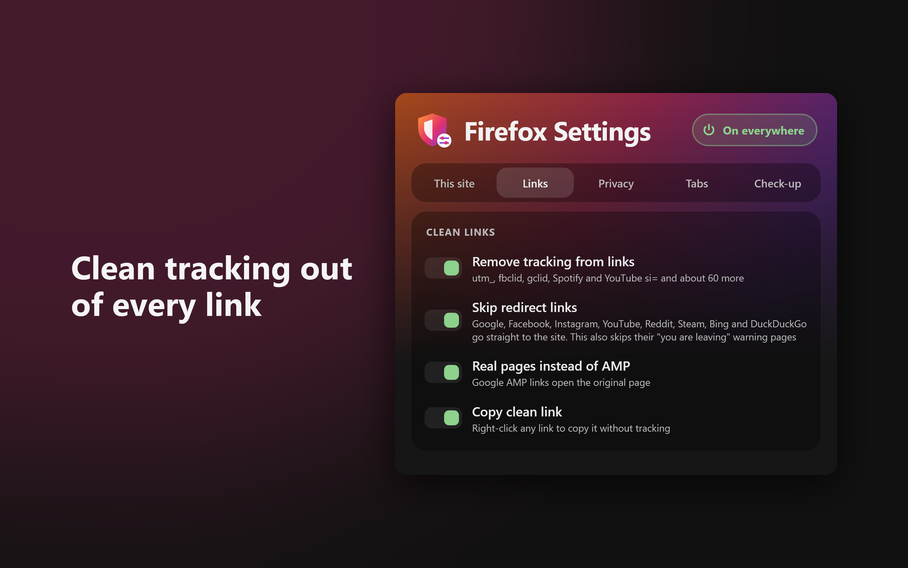
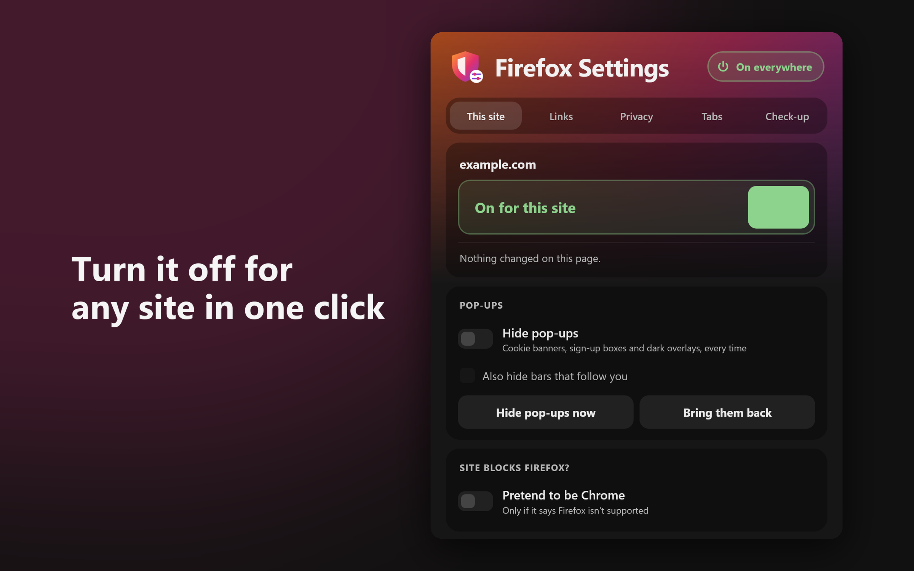
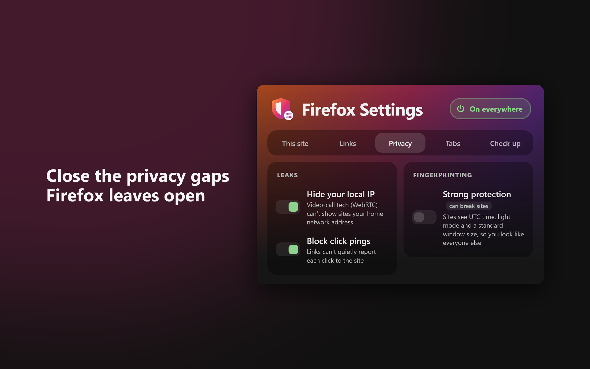

# More Settings for Firefox

A Firefox add-on with the privacy and tab extras that Firefox and uBlock Origin don't already do: clean links, remove pop-ups per site, pretend to be Chrome, hidden privacy settings and a duplicate-tab shortcut.

**[Install from Firefox Add-ons](https://addons.mozilla.org/firefox/addon/more-settings-for-firefox/)** (Firefox 128 or later)

It is made to sit next to uBlock Origin, not replace it. Keep uBlock Origin for ads and trackers, and set Firefox's Enhanced Tracking Protection to Strict.

## Features

- **Clean links**: removes utm_, fbclid, gclid and about 60 more tracking parameters, skips redirect links (Google, Facebook, Reddit and others) and opens real pages instead of AMP.
- **Copy clean link** in the right-click menu.
- **See what changed**: a number on the toolbar icon counts what the add-on changed on the page. The popup lists it, with **Open original link** to undo.
- **On/off per site**, and one button to turn the whole add-on off everywhere.
- **Remove pop-ups** on the sites you choose: cookie walls, sign-up boxes, dark overlays and scroll lock.
- **Pretend to be Chrome** on sites that say Firefox isn't supported.
- **Hidden privacy settings**: hide your local IP from WebRTC, block click pings, and optional strong fingerprint protection.
- **Duplicate tab** with a keyboard shortcut.
- **Check-up** of Firefox's own privacy settings, with where to change each one.

On install it hides your local IP and blocks click pings. Both are switches you can turn off.

## Keyboard shortcuts

| Keys | What it does |
|---|---|
| Alt+Shift+D | Duplicate the current tab (or all selected tabs). Change the keys in the popup's Tabs tab. |

## Privacy

- Collects no data and sends nothing anywhere. Settings are stored in Firefox on your own computer.
- It needs access to all sites so it can clean the links you open. It only looks at the pages you open, not images, scripts or other files.
- Pop-up removal and Chrome mode only run on sites you switch them on for.

## What it leaves to others

Some features from other privacy add-ons were left out because Firefox or uBlock Origin already do them:

| Left out | Already covered by |
|---|---|
| Tracker and malware blocklists | uBlock Origin, Enhanced Tracking Protection (Strict), Safe Browsing |
| Blocking JavaScript per site | uBlock Origin's `</>` switch |
| HTTPS upgrade, Global Privacy Control | Firefox settings (see Check-up) |
| Social button click-to-load | Enhanced Tracking Protection (Strict) |
| Canvas noise | Enhanced Tracking Protection (Strict), or the Strong protection switch here |
| Blocking sites from scanning your network | Firefox 153+ asks before a site can reach your local network |
| Forget this site | Firefox: padlock in the address bar > Clear cookies and site data |

## Report a problem

Open an issue on the [Issues page](https://github.com/TimWJT/more-settings-for-firefox/issues). Say what you expected, what happened, the site, and your Firefox version.

## For developers

- Run from source: open `about:debugging#/runtime/this-firefox`, click **Load Temporary Add-on…** and pick `manifest.json`.
- Build: `npx web-ext build`. Lint: `npx web-ext lint`.
- How each part works is in [EXPLAINED.md](EXPLAINED.md). Design notes are in [NOTES.md](NOTES.md).
- All code is written from scratch.

## Licence

All Rights Reserved. The source is public so it can be read and reviewed. See [LICENSE](LICENSE).

Not affiliated with Mozilla.
